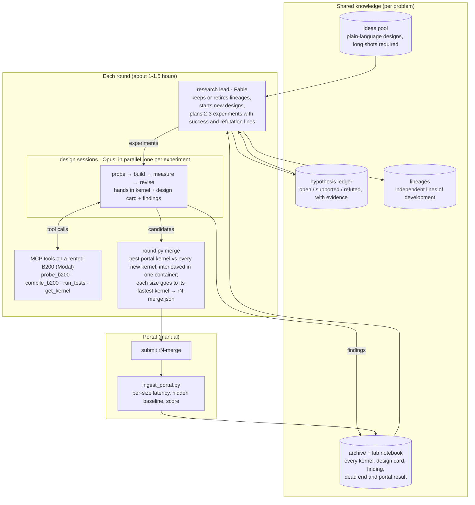

# solx

**Claude agents that design, race and merge B200 kernels for NVIDIA's SOL-ExecBench.**

An automated research loop for NVIDIA's [SOL-ExecBench](https://research.nvidia.com/benchmarks/sol-execbench)
leaderboard. Each round, a research lead (Claude Fable) reads everything learned so far and plans two or three
experiments. Parallel design sessions (headless Claude Code, Opus) then build and measure kernels on a rented B200
(Modal, pay per second). Finally, the loop times every new kernel against the best submitted one in the same container
and merges the winners, input size by input size, into one submission. The portal scores kernels on its own
clock-locked B200; submissions are made by hand.

## Where we are

As of 2026-10-13. Our scores are private portal submissions. The public #1 column comes from the 2026-09-20 board
snapshot, except #129, which is the live board.

| Board | Problem | Best | Public #1 |
|---|---|---|---|
| **L2 #129** | **`035_convnextv2_block_with_grn`** (7x7 depthwise conv, LayerNorm, MLP with GELU and GRN, residual; fp32; 16 sizes) | **0.7313** (`r8-merge`), 2nd on the live board | 0.7435 |
| L1 #35 | `035_flux_ada_layer_norm_zero_modulation_extraction` | 0.6941 | 0.7945 |
| L1 #88 | `088_rotary_position_embedding_application` | 0.6827 | 0.6978 |
| L1 #85 | `085_geglu_activation` | 0.6755 | 0.6905 |
| L1 #38 | `038_flux_multi_head_rmsnorm_qk` | 0.6125 | 0.6275 |
| L1 #84 | `084_silu_activation_backward` | 0.5219 | 0.5604 |
| FlashInfer #218 | `009_gemm_n5120_k2048` | 0.4870 | 0.5356 |
| L1 #30 | `030_attention_output_projection_with_residual` | 0.4529 | 0.5464 |

### #129: 0.30 to 0.73 in eight rounds

| Round | Submission | What changed | Portal |
|---|---|---|---|
| r0 | `r0-convnext-coop-fp32-anchor` | the research agent's first correct kernel (fp32, one cooperative launch) | 0.3038 |
| r2 | `r2-lib-cublaslt-fp16-tmaconv` | lineage A: a conv kernel plus cuBLASLt fp16 GEMMs | 0.6198 |
| r3 | `r3-merge-a3-b3-d3` | first per-size merge of three lineages: A's pipeline, B's cooperative mma.sync kernel, D's weight streaming | 0.6355 |
| r4 | `r4-merge-m3-a4` | A's bulk-plane conv on six sizes | 0.6553 |
| r5 | `r5-merge-b` | A's ring GEMM; the merge becomes an automatic loop step and learns that launch count changes the portal/bench ratio | 0.6747 |
| r6 | `r6-merge` | D's tcgen05 kernel, its epilogue spill fixed, takes the wide-channel sizes | 0.6908 |
| r7 | `r7-merge` | D's single-launch tcgen05 kernel reaches the small-channel sizes; new lineage G fuses conv, GEMM1, GELU and the GRN sums for the two largest | 0.7207 |
| r8 | `r8-merge` | D runs its GEMM1 epilogue on all 16 warps; G extends to two more sizes; new lineage H (a dataflow work queue) is refuted | 0.7313 |

Eight lineages (A-H) have been started so far. The lead has retired B, C, E and F and paused A, and H's first build was
refuted in r8. The current submission routes the 16 sizes across four kernels from lineages D and G.

## How the loop works



- **Lineages.** Refining a single kernel under portal noise turns into a noisy hill-climb that settles on the first
  design that works. The lead instead keeps several lineages: independent designs that share findings but not code.
  It starts a new design in most rounds and gives each new idea a round or two to mature before judging it. Because of
  the merge, a specialist that wins only a few sizes is still worth keeping.
- **Research lead.** Once per round, a Fable agent reads the ideas pool, the lab notebook (every portal result, and
  every finding earlier sessions recorded, dead ends included), the archive and the hypothesis ledger. It plans the
  round's experiments. Each one tests a hypothesis and states what would count as success and what would refute it.
- **Design sessions.** Each experiment is a headless Claude Code session on the user's Claude plan, with our tools
  served over MCP. A session first tests its idea's core assumption with quick probes on the rented B200 (an NVRTC
  kernel in about a second, timed the way NVIDIA's harness times it). It then builds the kernel and runs NVIDIA's
  harness on it: correctness at all sizes, run twice in the portal's order. It hands in one kernel with a design card
  (hypothesis, per-path design, resources, findings, precision log).
- **Per-size merge.** `loop/merge.py` wraps each kernel's sources in its own namespace and generates a binding that
  dispatches on the input shape. A manifest lets later merges take the parts apart again. The merge step times the
  best portal kernel and every new candidate alternately in one Modal container, since drift between containers is
  5-12 µs per size, larger than many real gains. It then projects each candidate's portal time using the
  portal/bench ratio that the candidate's own lineage shows on the portal. Projection vs result: r7 0.7208 vs 0.7207,
  r8 0.7333 vs 0.7313.
- **Rules.** Before each submission, the operator checks the merged code against the leaderboard rules: no state
  carried between calls, accumulators zeroed inside each call, no PDL, no stream or graph tricks, and diagnostics
  compiled out.
- **Emulator** (single-kernel problems such as #38). A Gaussian process learns `log(portal / bench)` per size from
  every kernel measured on both. The rented B200 boosts to about 1940 MHz; the portal locks the SM clock at 1500 MHz.

## Running

```bash
P=L2/035_convnextv2_block_with_grn             # any problem: L1/038, FlashInfer-Bench/009, 035_convnextv2_block_with_grn ...
# a new problem: measurements, problem card, first ledger, first kernel (round r0)
.venv/bin/python loop/round.py research --problem $P --backend claude
# a portfolio round
.venv/bin/python loop/round.py ideas --problem $P --round r9 --backend claude      # optional: a fresh ideas pool
.venv/bin/python loop/round.py lead  --problem $P --round r9 --backend claude --portfolio --max-tasks 3 [--brief "..."]
.venv/bin/python loop/round.py auto  --problem $P --round r9 --backend claude --use-plan --portfolio \
    --b200-minutes 90 --gpu-calls 10 --session-timeout 90    # sessions, then the merge -> rounds/r9/candidates/r9-merge.json
# after uploading: save the result page into html_results/, then
.venv/bin/python poc/ingest_portal.py html_results/<page>
.venv/bin/python poc/leader_gap.py $P                        # per-size gap to the public board and hardware ceilings
```

`round.py merge --round r9` reruns the merge step by itself, and `auto --resume` resumes sessions that hit a usage
limit. A portfolio round of three sessions takes about 1-1.5 hours and uses about $25-40 of API-equivalent usage on
the Claude plan plus $4-6 of B200 time.

## Repository layout

| Path | What it is |
|---|---|
| `loop/round.py` | the loop driver: research, ideas, lead, plan, auto, test, merge, shortlist, table |
| `loop/portfolio.py` | portfolio rounds: idea sessions, the premise audit, lineages, the lead protocol |
| `loop/merge.py` | per-size merge of several kernels into one submission (namespaced sources, shape dispatch, manifest) |
| `loop/ab_container.py` | interleaved timing of kernels in one Modal container, projected from portal times |
| `loop/order_check.py` | the portal-order check: every workload is set up before any is timed |
| `loop/problem.py`, `loop/research.py` | problem definitions, workload sizes and bands; the research phase |
| `problems/<name>/` | one folder per problem: `card.md` (briefing), `ledger.yaml`, `lineages.yaml`, `archive.json`, `rounds/` |
| `loop/mcp_tools.py`, `loop/designer.py` | the session tools (MCP server for headless Claude; OpenRouter tool loop) |
| `loop/b200_modal.py`, `loop/b200probe.py` | the rented B200 on Modal (NVIDIA's software stack) and the probe helpers |
| `loop/planner.py`, `loop/emulator.py` | score model, task planning, shortlist; the multi-fidelity emulator |
| `loop/context/` | the shared briefing: B200 architecture, public SOTA kernels, harness rules, playbook, protocol |
| `loop/archive.py` | the per-problem archive: every kernel's card, timings, compile statistics, portal results |
| `loop/dashboard/` | a local live view of the loop |
| `poc/leader_gap.py` | per-size gap to the public board, with DRAM and tensor-core ceilings |
| `poc/results/b200_portal*.csv` | every B200 portal result, per submission and per size |

## Lessons so far

- **Keep a portfolio and merge per size.** No single #129 design wins all 16 sizes. Specialists that lose overall but
  win a band carried most of the gains from r3 onwards.
- **Count launches.** On small and medium sizes the portal adds more per kernel launch than a rented B200 does. A
  single-launch cooperative kernel runs 1.20-1.32x its rented time on the portal; a 5-6 launch pipeline runs
  1.40-1.55x. The r5 projection missed by 0.008 until the merge used each lineage's own ratio.
- **Compare only inside one container.** Rented B200s differ by 5-12 µs per size between containers, even in launch
  speed. Back-to-back timing in one container is what made the merge projections hold.
- **The portal sets up every size before timing any.** Process-wide host state (maximum dynamic shared memory
  attributes, cached plans) must be valid for every shape in any order: one #129 kernel failed on eight sizes for this
  reason.
- **Keep outputs in L2** (#38). `evict_last` output stores gained +0.021: output still in the 126 MB L2 when the
  kernel ends is written back after the timer stops.
- **Portal precision depends on size.** On #38's large sizes, identical code moved at most 0.3% per size. On #129's
  sizes under 40 µs, it moves about ±1 µs, so gains of that size are noise.
- **Fast experiments change how the agents work.** With probes that take seconds, sessions test assumptions before
  building, run controls and record negative results, and the lab notebook stops later rounds repeating dead ends.
- **Portal arithmetic** (verified): latency is the geometric mean over sizes, the score is the arithmetic mean of
  per-size scores, and your own submission pages show the hidden baseline per size.

## Setup notes

- Local: `python3 -m venv --system-site-packages .venv && .venv/bin/pip install modal mcp`. Modal login:
  `.venv/bin/python -m modal setup`. The OpenRouter key (optional) is read from `.env` (git-ignored) and never printed.
- After cloning SOL-ExecBench, run `python3 loop/patch_dataset.py`. FlashInfer-Bench definitions leave the metadata
  field `hf_id` empty, which the harness's data model rejects; the script fills it in our local copy only.
- The B200 image follows SOL-ExecBench's Dockerfile (CUDA 13.1.1, CUTLASS 4.4.1, the uv-locked environment, fbtriton
  3.7.1). Our copy of the harness skips timing windows that hold none of the user's kernels, because of CPU/GPU
  timestamp skew on Modal (`loop/patch_harness_timing.py`); the portal never needs this.
- CUDA C++ solutions use two files (`kernel.cu` without PyTorch headers, `binding.cpp`), which cuts a B200 build
  from about a minute to 9-18 s. tcgen05 kernels must target B200 only.
- CSF3 (optional): everything lives in `/scratch/t95317ha/solx`; account `gpu-cdt-dmcs` for H200, `gpu-sk01` for
  A100/L40S.
- The portal has no official upload API, so submission stays manual.

## Dashboard

A local live view of the optimisation loop (standard library only, bound to 127.0.0.1):

    .venv/bin/python loop/dashboard/server.py [--port 8765]    # then open http://127.0.0.1:8765/

Home shows the pipeline graph (active nodes light up from running `loop/round.py` processes and each running
session's latest tool call), a card per problem, and a live agent feed. Click through to a problem (card, ledger,
kernels, per-workload chart, rounds), a round (plan, lead reply, sessions, candidates) and a session (live feed over
Server-Sent Events). Drag a saved portal page (`.html`) onto any screen to save it into `html_results/` and run
`poc/ingest_portal.py` on it; the script output appears in a panel. Code lives in `loop/dashboard/`.
